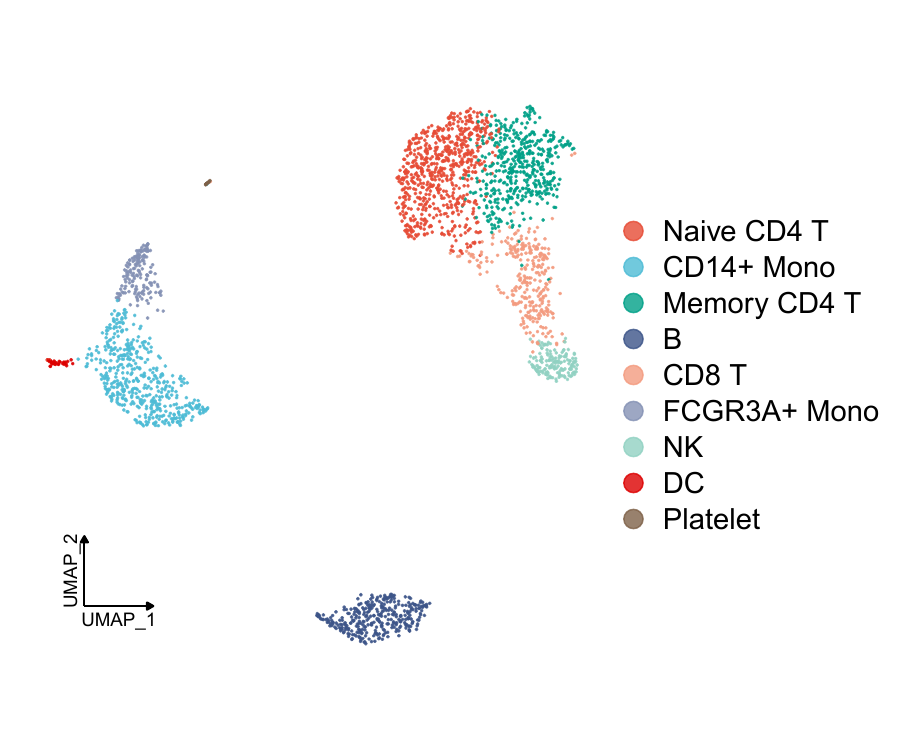
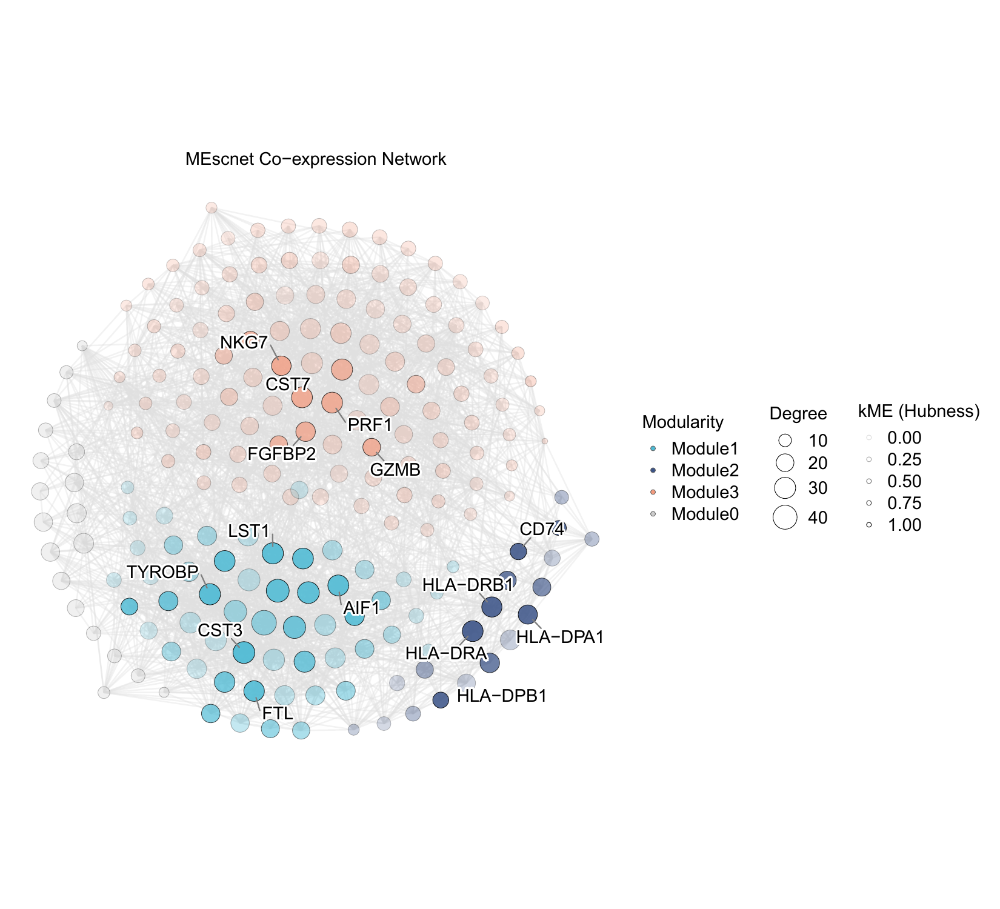

# Mescnet

**Mescnet** (*maximum-entropy single-cell gene network*) reconstructs
context-specific gene programs from single-cell and spatial transcriptomics
data.

Cells are aggregated into local **metacells** to reduce expression sparsity.
Gene relationships are estimated from marginal correlation and partial
correlation, combined into a `BayesCor` score, soft-thresholded into a weighted
network, and partitioned into modules with Leiden community detection. The
package also provides plotting helpers for UMAPs, UCell module scores,
kME-scaled network views, and hub-gene heat maps.

## Installation

### 1. Install the package manager and Seurat

Mescnet requires R >= 4.1 and Seurat v5 (`SeuratObject` >= 5.0.0).

```r
install.packages(c("remotes", "BiocManager", "Seurat"))
```

### 2. Install optional visualization and scoring dependencies

The core network workflow does not require every optional package. Install the
ones you need for the figures you plan to make.

```r
# Co-expression network visualization
remotes::install_github("Jiawang1209/ggNetView",
                        dependencies = TRUE, upgrade = "never")

# UCell module scores (Bioconductor)
BiocManager::install("UCell", ask = FALSE, update = FALSE)
```

### 3. Install Mescnet

```r
remotes::install_github("FangZY-Lab/Mescnet",
                        dependencies = TRUE, upgrade = "never")
```

Then check the installation:

```r
library(Mescnet)
packageVersion("Mescnet")
```

If R asks to update many unrelated packages, keep `upgrade = "never"` and
restart the R session after installation. The optional EGAD benchmark needs:

```r
install.packages("EGAD")
BiocManager::install(c("AnnotationDbi", "org.Hs.eg.db"),
                     ask = FALSE, update = FALSE)
```

## Quick start

```r
library(Seurat)
library(Mescnet)

seurat_obj <- CreaterMEscnet(
  seurat_obj,
  nfeatures = 2000,
  group.by = "cell_type",
  reduction = "umap",
  k = 10,
  max_shared = 5,
  target_metacells = 500,
  group_name = c("CD14+ Mono", "CD8 T", "B")
)

seurat_obj <- pick_power_scale_free_power(seurat_obj)

# number = 3 selects the bayes_cor2 adjacency matrix
seurat_obj <- ComputeMEscnetModules(
  seurat_obj,
  min_genes_per_module = 18,
  resolution = 0.5,
  number = 3
)

module_genes <- seurat_obj@misc$MEscnet$MEscnet_modules$gene_lists
tom_matrix <- seurat_obj@misc$MEscnet$bayes_cor2

Plot_UMAP(seurat_obj, group.by = "cell_type")
Plot_Module_Scores(seurat_obj, module_genes, group.by = "cell_type")
Plot_MEscnet_Network(seurat_obj, tom_matrix, module_genes, top_n = 5)
Plot_Hub_Heatmap(
  seurat_obj,
  tom_matrix,
  module_genes,
  target_cells = c("CD14+ Mono", "FCGR3A+ Mono", "DC", "B", "NK", "CD8 T"),
  top_n = 5
)
```

## Case study

The PBMC example includes the complete script, parameter guide, and all result
figures:

**[Open the PBMC case study](case-study/README.md)**

The input object is available from the GitHub release:

```r
download.file(
  paste0(
    "https://github.com/FangZY-Lab/Mescnet/releases/download/",
    "untagged-d0b110f2c48eeb2bfd42/pbmc.Rdata"
  ),
  destfile = "pbmc.Rdata",
  mode = "wb"
)
```

Run the case study from the repository root after downloading the file:

```r
source("case-study/Mescnet_PBMC_case_study.R")
```

The input object is available from the GitHub release:

```r
download.file(
  paste0(
    "https://github.com/FangZY-Lab/Mescnet/releases/download/",
    "untagged-d0b110f2c48eeb2bfd42/pbmc.Rdata"
  ),
  destfile = "pbmc.Rdata",
  mode = "wb"
)
```

Run the case study from the repository root after downloading the file:

```r
source("case-study/Mescnet_PBMC_case_study.R")
```

The input object is available from the GitHub release:

```r
download.file(
  paste0(
    "https://github.com/FangZY-Lab/Mescnet/releases/download/",
    "untagged-d0b110f2c48eeb2bfd42/pbmc.Rdata"
  ),
  destfile = "pbmc.Rdata",
  mode = "wb"
)
```

Run the case study from the repository root after downloading the file:

```r
source("case-study/Mescnet_PBMC_case_study.R")
```





## Key parameters

### Network construction

| Parameter | Meaning |
| --- | --- |
| `gene_list` | Custom genes used for network inference. When supplied, it replaces HVG selection. |
| `nfeatures` | Number of highly variable genes used when `gene_list = NULL`. The default is 2000. |
| `group.by` | Metadata column defining cell groups. Metacells are built within these groups. |
| `reduction` | Dimensional reduction used for nearest-neighbour cell aggregation. Use the reduced space that best resolves the populations of interest. |
| `k` | Number of nearest neighbours used to build each metacell. Larger values make smoother metacells. |
| `max_shared` | Maximum number of cells that two metacells may share. Lower values reduce overlap. |
| `target_metacells` | Target number of metacells requested for each group. This controls the resolution of the inferred network. |
| `group_name` | One or more levels of `group.by` whose metacells form the network expression matrix. This defines the biological context of the network. |

### Module detection

| Parameter | Meaning |
| --- | --- |
| `min_genes_per_module` | Communities smaller than this are discarded and their genes are treated as unassigned (`"grey"`). |
| `resolution` | Leiden resolution. Larger values produce more, smaller modules; smaller values produce fewer, larger modules. |
| `number` | Index of the association matrix: `1 = pcor`, `2 = bayes_cor1`, ..., `7 = bayes_cor6`. |
| `seed` | Random seed for Leiden clustering. |

### Plotting

| Parameter | Meaning |
| --- | --- |
| `top_n` | Number of hub genes selected **per module** by absolute kME. It is not a total across modules. |
| `target_cells` | Cell groups displayed in the hub-gene heat map. |
| `group.by` | Metadata column used for colours or grouping in a plot. |
| `palette` | Optional named or unnamed colour vector. Named colours are matched to cell-group labels. |
| `edge_threshold` | Minimum association value retained as an edge in `Plot_MEscnet_Network()`. |

### Selecting an association matrix

`ComputeMEscnetModules(number = )` indexes `seurat_obj@misc$MEscnet$adj_matrices`:

| `number` | Matrix | Definition |
| --- | --- | --- |
| 1 | `pcor` | partial correlation only |
| 2 | `bayes_cor1` | `abs(pcor) * abs(cor)` |
| 3 | `bayes_cor2` | `pmax(pcor, 0) * pmax(cor, 0)` |
| 4 | `bayes_cor3` | min-max normalised `pcor * cor` |
| 5 | `bayes_cor4` | signed-hybrid normalised `pcor * cor` |
| 6 | `bayes_cor5` | z-scored `pcor * cor` |
| 7 | `bayes_cor6` | `((1 + pmax(pcor, 0)) / 2) * pmax(cor, 0)` |

`pick_power_scale_free_power()` stores both the unthresholded association
matrices (`pcor`, `bayes_cor1` ... `bayes_cor6`) and the soft-thresholded
adjacencies (`adj_matrices`). Module detection uses `adj_matrices[[number]]`.
Use the matching `adj_matrices` entry for a network view if you want the graph
to reflect the soft-thresholded matrix exactly.

## What is stored in the Seurat object

Results are stored under `seurat_obj@misc$MEscnet`:

| Element | Content |
| --- | --- |
| `datExpr` | metacell expression matrix, cells x genes |
| `MEscnet_genes` | genes selected for the network |
| `MEscnet_params` | metacell aggregation parameters |
| `MEscnet_metacell_obj` | the metacell Seurat object |
| `MEscnet_ppcor` | partial correlation matrix |
| `bayes_cor1` ... `bayes_cor6` | integrated association matrices |
| `result_tables` | scale-free fit diagnostics per power |
| `recommended_powers` | selected power per association matrix |
| `adj_matrices` | soft-thresholded adjacency matrices |
| `moduleColors` | module label per gene, `"grey"` for unassigned genes |
| `MEscnet_modules` | `module_ids`, `module_sizes`, and `gene_lists` |
| `MEscnet_network` | the clustered `igraph` graph |

```r
datExpr <- seurat_obj@misc$MEscnet$datExpr
module_genes <- seurat_obj@misc$MEscnet$MEscnet_modules$gene_lists
colors <- seurat_obj@misc$MEscnet$moduleColors
```

## Plotting API

| Function | Purpose |
| --- | --- |
| `Plot_UMAP()` | Clean UMAP with axis arrows. |
| `Plot_Module_Scores()` | UCell scores as feature plots and grouped violin plots. |
| `Plot_MEscnet_Network()` | Module-coloured network with kME-scaled node transparency and per-module hub labels. |
| `Plot_Hub_Heatmap()` | Heat map of the top hub genes from each module across selected cell groups. |
| `Mescnet_colors()` | Consistent high-contrast palette used by the plotting helpers. |

All plot functions return the plot object and can write a PDF with their
`save_path`, `feature_file`, `violin_file`, or `output_file` argument. Set the
file argument to `NULL` to skip writing.

## Dependencies by task

| Task | Packages |
| --- | --- |
| Network construction | `Seurat`, `SeuratObject`, `hdWGCNA`, `ppcor`, `igraph` |
| Core plotting | `ggplot2`, `patchwork`, `ggrepel`, `tidygraph`, `ggNetView` |
| Module scores | `UCell` |
| Network benchmarking | `EGAD`, `AnnotationDbi`, `org.Hs.eg.db` |

`hdWGCNA` is used internally for metacell and WGCNA-style data structures. It is
one component of the workflow, not the only dependency; users do not need to
load it explicitly for the standard Mescnet workflow.

## Seurat v5 compatibility

Mescnet provides Seurat v5 compatible `MetacellsByGroups()` and
`MetaspotsByGroups()` implementations. They read assay layers through the
Seurat v5 API, join layers after merging metacells or metaspots, and keep group
metadata synchronized. Because the function names overlap with hdWGCNA, call
`Mescnet::MetacellsByGroups()` explicitly if both packages are attached.

## Citation

If you use Mescnet, please cite the accompanying manuscript. See the repository
for the current reference.

## License

GPL (>= 3). Metacell and metaspot aggregation code is derived from hdWGCNA,
which is released under the same license.
