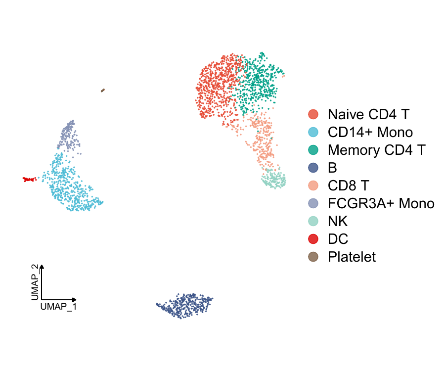
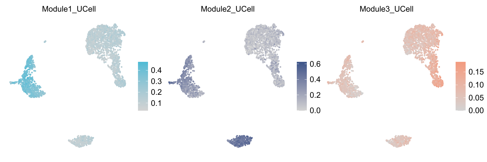
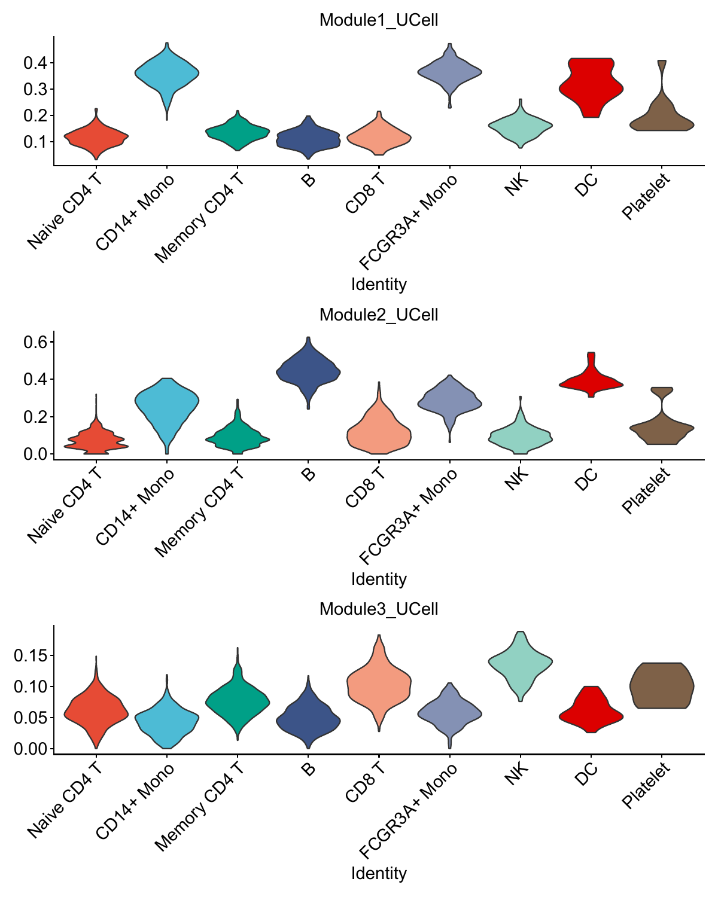
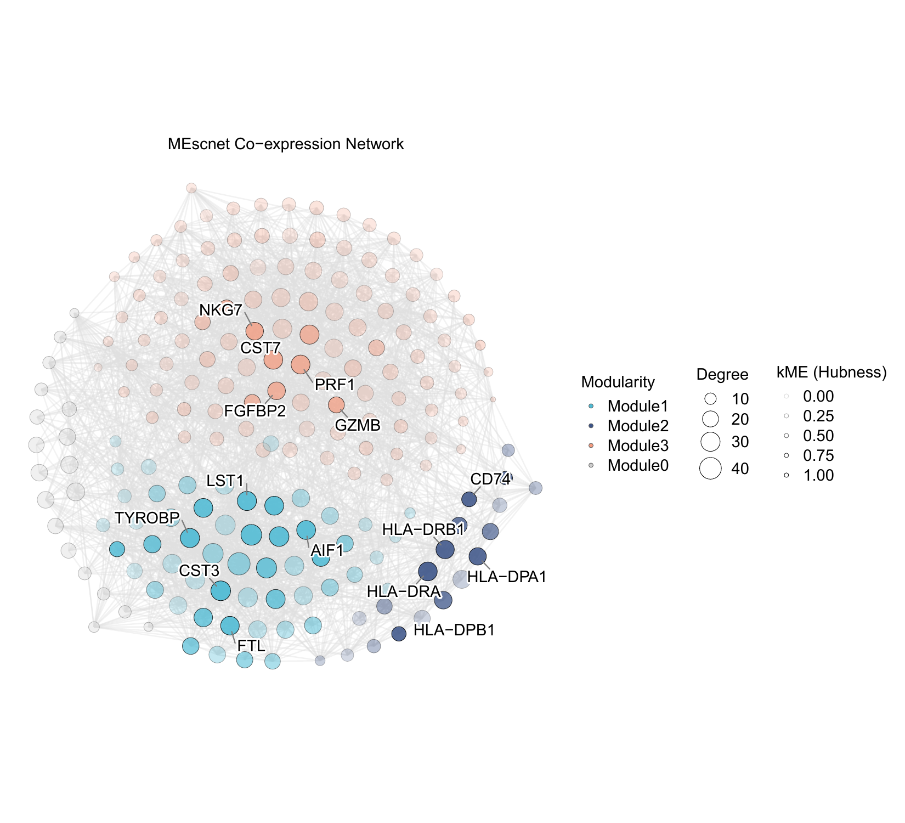
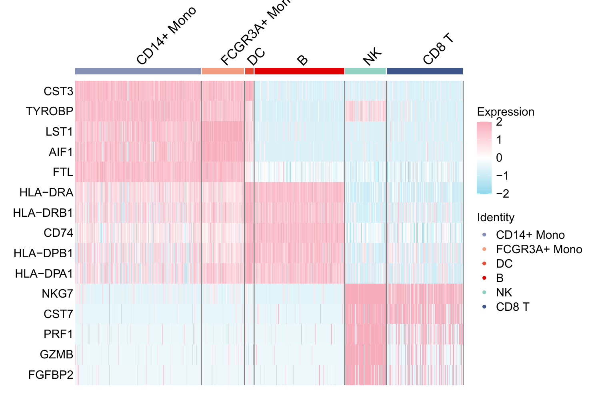

# PBMC case study

This case study reconstructs Mescnet modules in a PBMC dataset and recreates
five publication-style figures:

- a UMAP of cell types,
- UCell module scores on the UMAP,
- UCell module scores by cell type,
- a co-expression network with the top hub genes labelled, and
- a hub-gene expression heat map.

The complete executable script is
[`Mescnet_PBMC_case_study.R`](Mescnet_PBMC_case_study.R).

## 1. Input data

The input object is `pbmc.Rdata` and must contain `seurat_obj`, with a
`cell_type` metadata column and a `umap` reduction. The file is not committed
because it is approximately 287 MB. Download it from the GitHub release into
the **repository root**:

```r
download.file(
  paste0(
    "https://github.com/FangZY-Lab/Mescnet/releases/download/",
    "untagged-d0b110f2c48eeb2bfd42/pbmc.Rdata"
  ),
  destfile = "pbmc.Rdata",
  mode = "wb"
)
```

[Direct data download](https://github.com/FangZY-Lab/Mescnet/releases/download/untagged-d0b110f2c48eeb2bfd42/pbmc.Rdata)

The expected layout is:

```text
Mescnet/
  pbmc.Rdata
  case-study/
    Mescnet_PBMC_case_study.R
```

## 2. Installation

Install the package and its optional plotting dependencies. See the
[package README](../README.md#installation) for the full installation guide,
including troubleshooting and the optional EGAD benchmark dependencies.

```r
install.packages(c("remotes", "BiocManager", "Seurat"))

remotes::install_github("Jiawang1209/ggNetView",
                        dependencies = TRUE, upgrade = "never")
BiocManager::install("UCell", ask = FALSE, update = FALSE)
remotes::install_github("FangZY-Lab/Mescnet",
                        dependencies = TRUE, upgrade = "never")
```

Or run [`install_dependencies.R`](install_dependencies.R). Restart R after
installation.

## 3. Run the case study

From the repository root:

```r
source("case-study/Mescnet_PBMC_case_study.R")
```

The figures are written to `case-study/figures/`.

## 4. Workflow

```r
seurat_obj <- CreaterMEscnet(
  seurat_obj,
  nfeatures = 203,
  group.by = "cell_type",
  reduction = "umap",
  k = 10,
  max_shared = 5,
  target_metacells = 100,
  group_name = c("CD14+ Mono", "CD8 T", "B")
)

seurat_obj <- pick_power_scale_free_power(seurat_obj)

seurat_obj <- ComputeMEscnetModules(
  seurat_obj,
  min_genes_per_module = 18,
  resolution = 0.5,
  number = 3
)

module_genes1 <- seurat_obj@misc$MEscnet$MEscnet_modules$gene_lists
tom_matrix <- seurat_obj@misc$MEscnet$bayes_cor2
```

`module_genes1` is defined explicitly from the module result. The original
master script passed this object to the plotting functions without first
creating it; that omission is fixed here.

`number = 3` selects `bayes_cor2` from `adj_matrices`:

| `number` | Matrix |
| --- | --- |
| 1 | `pcor` |
| 2 | `bayes_cor1` |
| 3 | `bayes_cor2` |
| 4 | `bayes_cor3` |
| 5 | `bayes_cor4` |
| 6 | `bayes_cor5` |
| 7 | `bayes_cor6` |

The unthresholded `bayes_cor2` matrix is retained in `tom_matrix` for
reproducibility. The soft-thresholded network used for module detection is
available as
`seurat_obj@misc$MEscnet$adj_matrices[["bayes_cor2"]]`; use that matrix if the
network figure should match the exact adjacency passed to Leiden.

## 5. Parameter guide

| Parameter | Value in this case | Meaning |
| --- | --- | --- |
| `nfeatures` | `203` | Number of highly variable genes used when `gene_list = NULL`. Increase it to retain more genes; decrease it for a smaller, faster network. |
| `gene_list` | not supplied | Optional custom gene vector. When supplied, it overrides HVG selection and `nfeatures` is not used. |
| `group.by` | `"cell_type"` | Metadata column containing cell labels. Metacells are built within these labels. |
| `reduction` | `"umap"` | Reduced space used to find neighbouring cells for metacell construction. |
| `k` | `10` | Number of nearest neighbours aggregated into each metacell. |
| `max_shared` | `5` | Maximum overlap allowed between two metacells. |
| `target_metacells` | `100` | Target number of metacells requested per group. |
| `group_name` | three cell types | The groups whose metacells form the expression matrix used for network inference. This defines the network's biological context. |
| `min_genes_per_module` | `18` | Modules smaller than this are discarded. |
| `resolution` | `0.5` | Leiden resolution. Larger values give more, smaller modules. |
| `number` | `3` | Selects `bayes_cor2` for module detection. |
| `top_n` | `5` | Number of hub genes selected **per module** by absolute kME, not five genes in total. |
| `target_cells` | six immune groups | Cell groups shown in the hub-gene heat map. |

## 6. Results

### Cell-type UMAP



[Download the PDF](figures/UMAP_PBMC_Nature.pdf)

### UCell module scores on the UMAP



[Download the PDF](figures/FeaturePlot_Modules.pdf)

### UCell module scores by cell type



[Download the PDF](figures/VlnPlot_Modules.pdf)

### Co-expression network and hub genes

Node colour indicates module membership and node transparency scales with
absolute kME. The five highest-|kME| genes from each module are labelled, so the
number of labels is up to `top_n × number_of_modules`.



[Download the PDF](figures/MEscnet_ggNetView_Nature_Hubs.pdf)

### Hub-gene heat map

The heat map shows the same per-module hub selection across the requested cell
groups.



[Download the PDF](figures/Figure_E_HubGenes_Heatmap.pdf)

## 7. Reproducibility notes

- Set `set.seed()` before module detection if you need to compare closely
  matched runs; `ComputeMEscnetModules()` also exposes its own `seed` argument.
- A network built from a different number of HVGs, metacells, or cell groups is
  a different network. Keep those parameters fixed when comparing modules.
- `top_n` controls only which hub genes are labelled or displayed; it does not
  change the modules themselves.
- UCell scores are computed from the Seurat assay specified by `assay`
  (`"RNA"` in this case).
